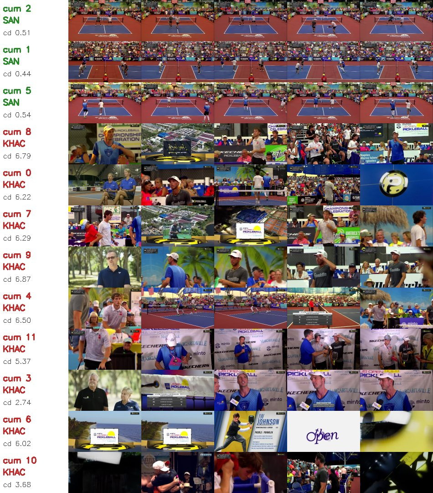
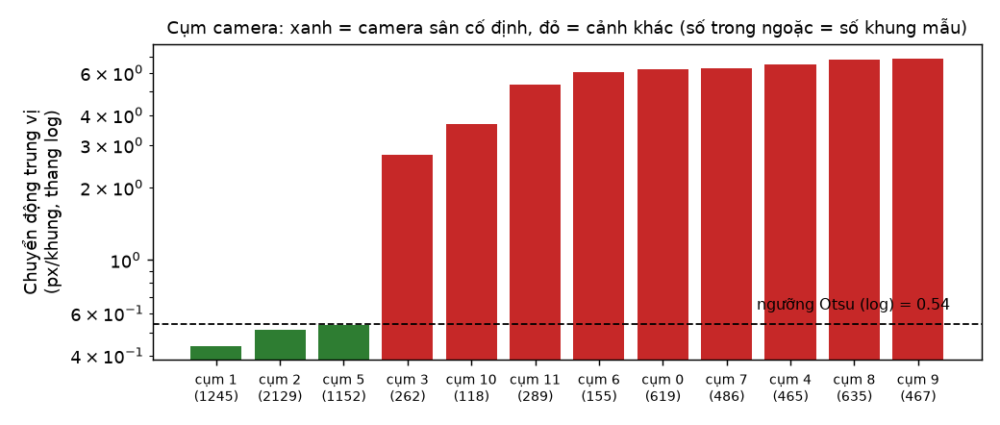
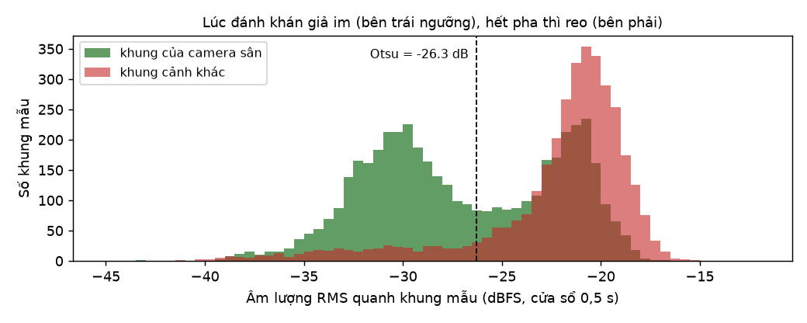
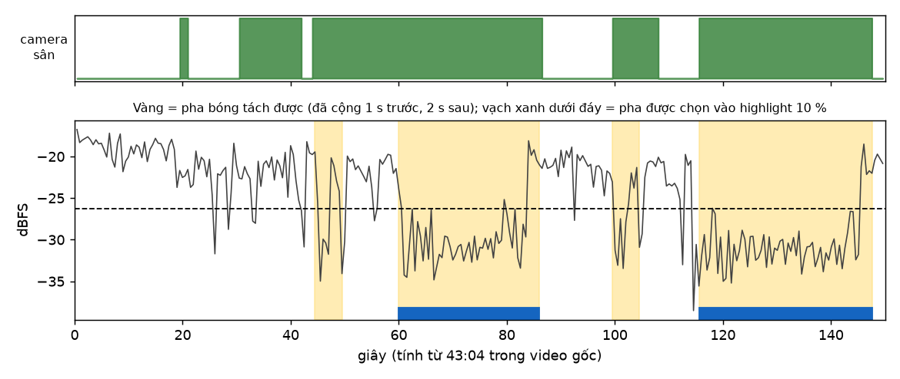
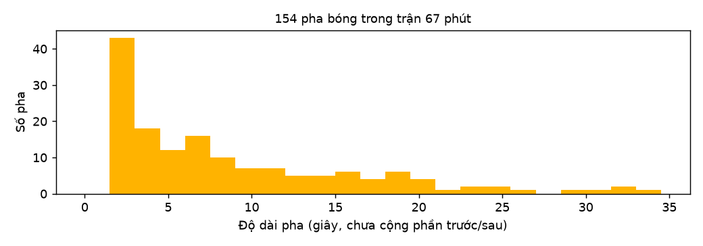
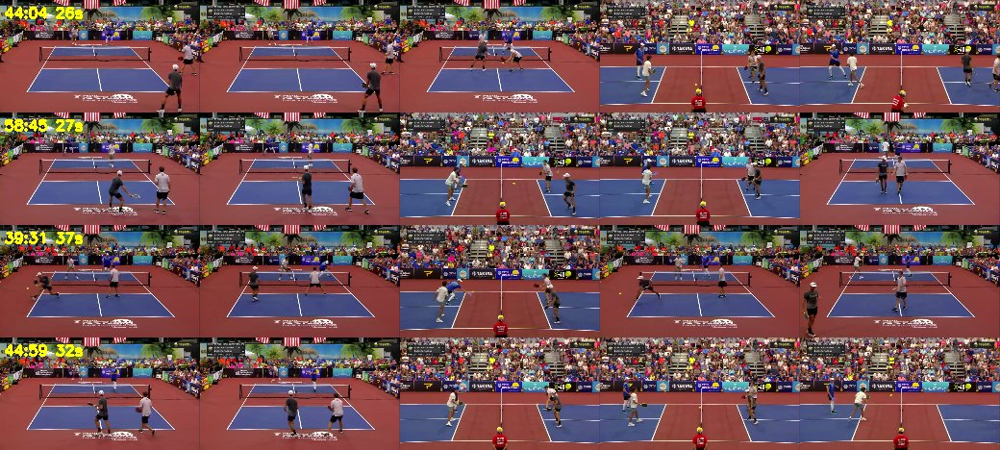

# Tách pha bóng để làm highlight: thuật toán và các bước xử lý

*anhnhc · 08/11/2026 · nhánh `rally-highlight` · code ở `core.py`*

Ghi chú này giải thích cách VideoLens nhận ra **một pha bóng** trong video phát sóng môn vợt, và vì sao nó bỏ được các cảnh quay khán đài, cận mặt vận động viên, phỏng vấn, đồ họa. Mọi con số dưới đây đo trên một trận pickleball 67 phút (854×480, 29,97 fps), chạy bằng code hiện tại của nhánh.

## 1. Bài toán và tiêu chí

Highlight phải là những pha tranh bóng hấp dẫn hoặc phát bóng ăn điểm, và phải lấy **trọn pha**: từ lúc chuẩn bị phát bóng tới lúc bóng chết. Không cắt vụn 1–2 giây, không chuyển cảnh liên tục. Tiêu chí đầy đủ nằm ở cuối `README.md`.

## 2. Vì sao cách cũ hỏng

Cách cũ chia video theo "chuyển cảnh" (độ lệch histogram HSV + sai khác khung), rồi chấm điểm từng mẩu ≤ 4 giây theo chuyển động, khuôn mặt, độ nét.

| Đo trên trận 67 phút | Cách cũ |
|---|---|
| Số lần "chuyển cảnh" phát hiện | 1 243 (gần như giây nào cũng có) |
| Số đoạn trong highlight | 519 |
| Độ dài đoạn (trung vị / dài nhất) | 1,0 s / 3,7 s |

Người chạy và bóng bay làm histogram thay đổi, nên bị tưởng là chuyển cảnh. Cách này không có khái niệm "pha bóng", nên mới cắt ngang lúc chuẩn bị phát bóng.

## 3. Ý tưởng: hai dấu hiệu cùng lúc

Một pha bóng trên sóng truyền hình có hai dấu hiệu đi cùng nhau:

1. **Hình:** đài dùng **camera cố định quay toàn sân**. Bố cục màu gần như không đổi (sân xanh, nền đỏ, khán đài phía sau) và hình gần như đứng yên. Ngược lại, cận mặt, khán giả, phỏng vấn, đồ họa đều quay tay, zoom, lia, hoặc là hình động, nên chuyển động lớn hơn khoảng 10 lần.
2. **Tiếng:** trong lúc đánh **khán giả im**; hết pha thì **reo**.

Pha bóng = những lúc **camera sân đang lên hình VÀ khán giả đang im**. Cả hai ngưỡng đều do **Otsu** tự chọn theo từng video, không đặt tay.

## 4. Các bước xử lý

### Bước 1. Lấy mẫu khung hình (`analyze`)

- Lấy 2 khung/giây (bước = `round(fps/2)` = 15 khung). Dùng `cap.grab()` để bỏ qua khung không cần, chỉ `cap.retrieve()` khung được lấy mẫu. Trận 67 phút cho 8 022 khung mẫu, phân tích mất 107 giây trên CPU.
- Thu nhỏ mỗi khung về 320×180.

### Bước 2. Đặc trưng hình của mỗi khung mẫu

| Đặc trưng | Cách tính | Dùng để |
|---|---|---|
| Bố cục màu | Đổi sang **Lab**, thu về **16×9** (`INTER_AREA`), duỗi thành vector 432 số | Gom khung cùng một góc camera |
| Chuyển động | **Optical flow Farneback** giữa hai khung mẫu liền nhau, lấy trung bình độ lớn vector (px) | Phân biệt camera cố định với quay tay/lia/zoom |

Lab được chọn vì khoảng cách trong Lab gần với cảm nhận màu của mắt. Thu về 16×9 để chỉ giữ **bố cục lớn** (mảng sân, mảng khán đài) mà bỏ chi tiết người chạy.

### Bước 3. Âm lượng (`audio_loudness`)

Tách âm thanh bằng ffmpeg (mono, 8 kHz). Với mỗi khung mẫu, tính **RMS trong cửa sổ 0,5 s** quanh nó và đổi sang dBFS: `10·log10(trung bình bình phương mẫu)`. Dùng tổng tích lũy nên tính nhanh cho cả trận.

### Bước 4. Gom cụm góc camera

**K-means 12 cụm** trên vector bố cục màu (`random_state=42`). Mỗi cụm là một "kiểu cảnh". Hình dưới là 5 khung ngẫu nhiên của từng cụm, nhãn SÂN/KHÁC là kết quả của bước 5.



### Bước 5. Tìm camera sân: Otsu trên log chuyển động (`detect_rallies`)

- Với mỗi cụm, lấy **trung vị chuyển động** của các khung trong cụm.
- Chạy **Otsu** trên `log(trung vị chuyển động)` của 12 cụm, trọng số là số khung của cụm. Cụm ở phía thấp là camera sân cố định.
- Trận này: ngưỡng ≈ 0,54 px/khung. Ba cụm sân có trung vị 0,44–0,54; chín cụm còn lại 2,7–6,9.

Phải dùng **thang log** vì chuyển động khác nhau theo **tỉ lệ** (quay tay gấp khoảng 10 lần camera cố định). Bản đầu dùng Otsu trên thang thường, ngưỡng rơi vào 2,75 và cụm 3 (phỏng vấn, trung vị 2,74) bị xếp nhầm vào "sân".



Kết quả: 4 526 khung mẫu (37,8 phút) thuộc camera sân.

### Bước 6. Tìm lúc khán giả im: Otsu trên âm lượng

Phân bố âm lượng của cả trận có hai đỉnh rõ. **Otsu** chọn ngưỡng **−26,3 dBFS**. Trung vị âm lượng: lúc camera sân lên hình và đang im là −30,4 dB; lúc camera sân mà ồn (giữa hai điểm, reo hò) là −21,8 dB; các cảnh khác là −21,1 dB.



### Bước 7. Ghép thành pha bóng

1. `chơi = camera sân AND im`.
2. **Lấp lỗ** ≤ 1 s nằm giữa hai đoạn "chơi" (một tiếng động ngắn, một lần đổi góc ngắn).
3. Bỏ đoạn ngắn hơn **1,5 s**.
4. Mở rộng mỗi pha **1 s trước** để có động tác phát bóng, nhưng **không lùi quá đầu cảnh sân**: nếu ngay trước đó là cảnh cận mặt thì pha bắt đầu đúng lúc cắt sang sân. Mở rộng thêm **2 s sau** để có tiếng reo.
5. Hai pha sát nhau mà phần mở rộng chồng lên nhau thì cắt ở giữa khoảng nghỉ.

Hình dưới là 150 giây quanh pha điểm cao nhất (từ 43:04). Dải xanh trên là lúc camera sân lên hình. Vùng vàng là các pha tách được. Vạch xanh dưới đáy là pha được chọn vào highlight 10 %.



### Bước 8. Chấm điểm pha

Điểm = trung bình hai **thứ hạng phần trăm** (percentile rank) trong cùng trận:

- **Độ dài pha**: đánh qua lại càng lâu càng hấp dẫn.
- **Tiếng reo**: âm lượng lớn nhất trong **3 s** sau khi pha kết thúc.

Dùng thứ hạng thay vì giá trị thô để hai đại lượng khác đơn vị (giây và dB) có cùng thang 0–1.

### Bước 9. Chọn pha cho highlight (`select(mode='rally')`)

Xếp pha theo điểm giảm dần, lấy dần cho tới hết ngân sách thời lượng. **Một pha hoặc lấy trọn, hoặc bỏ**, không bao giờ cắt ngắn. Có thể chọn knapsack 0/1 thay cho cách tham lam. Highlight ghép các pha theo đúng thứ tự thời gian.

## 5. Kết quả trên trận 67 phút

| Đo | Giá trị |
|---|---|
| Số pha tách được | 154 |
| Độ dài pha (p10 / trung vị / p90 / dài nhất) | 1,5 / 6,3 / 18,5 / 33,5 s |
| Tổng thời lượng các pha (chưa cộng phần trước/sau) | 21,9 phút |
| Highlight 5 % | 7 pha, 3,3 phút, mỗi pha 15,5–36,5 s |
| Highlight 10 % | 17 pha, 6,7 phút, mỗi pha 12,5–36,5 s |
| Highlight 15 % | 29 pha, 10,0 phút, mỗi pha 3,3–36,5 s |
| Thời gian trên CPU | phân tích 107 s, xuất video 14 s |



Bốn pha điểm cao nhất, mỗi hàng là một pha. Từ trái sang: 1 s trước phát bóng, lúc phát bóng, giữa pha, cuối pha, tiếng reo.



Chưa có nhãn của người gán nên **chưa có số đo độ chính xác**. Các số trên chỉ là kiểm bằng mắt.

## 6. Vì sao cách này loại được khán đài và vận động viên

| Loại cảnh | Bị loại ở bước | Lý do |
|---|---|---|
| Cận mặt vận động viên, khán giả | 5 | Quay tay, zoom: chuyển động trung vị 5–7 px/khung |
| Phỏng vấn sau trận | 5 | Bố cục khác hẳn sân; chuyển động 2,7 px/khung, vẫn trên ngưỡng log |
| Đồ họa, logo, flycam | 5 | Hình động, chuyển động lớn |
| Toàn sân lúc giữa hai điểm (nhặt bóng, đi về vị trí) | 6 | Camera sân nhưng âm lượng trên ngưỡng −26,3 dB (trung vị lúc này −21,8 dB) |
| Toàn sân lúc đang đánh | được giữ | Camera cố định và khán giả im |

## 7. Giới hạn đã thấy

- **Camera lia theo bóng bị loại.** Cụm 0 và cụm 4 có lẫn cảnh sân quay từ góc hông khi camera lia. Chuyển động lớn nên chúng bị xếp vào "khác", và phần pha bóng chiếu bằng camera đó bị mất hoặc làm pha bị cắt đôi.
- **Pha rất ngắn có thể là giả.** 43 pha chỉ dài 1,5–3 s; nhiều khả năng là lúc im lặng giữa hai điểm. Chúng ít khi được chọn vì điểm ưu tiên pha dài.
- **Phát bóng ăn điểm trực tiếp bị lép vế.** Pha ngắn nên thứ hạng độ dài thấp, chỉ được bù nếu tiếng reo rất to. Muốn nhận ra chắc chắn thì phải theo dõi được quả bóng.
- **Phụ thuộc khán giả im lặng.** Đúng với pickleball và tennis; không dùng nguyên được cho bóng đá, bóng rổ, nơi khán giả ồn suốt trận.
- **Một trận, một giải.** Mới chạy trên một trận; số cụm K = 12 chưa thử với video khác.
- **Chưa có nhãn người** để đo độ chính xác và F1 so với highlight do người chọn.

## 8. Ảnh cầu thủ lúc vung vợt (thử nghiệm, `best_shots`)

Trong mỗi pha được chọn: trừ nền **MOG2**, lọc hình thái (mở/đóng, co), gán nhãn thành phần liên thông; giữ thành phần cao hơn 12 % khung, cao hơn rộng, **chân đứng trên màu sàn** và không chạm mép khung. Bám cùng một người qua các khung bằng độ chồng hộp (IoU). "Lúc ra lực" = lúc **dáng người đổi nhiều nhất**, đo bằng `1 − IoU` mặt nạ hai khung liên tiếp; quanh đó lấy khung có **phương sai Laplacian** (độ nét) lớn nhất.

Mới khoảng 4/12 ảnh dùng được; số còn lại dính hai người, chỉ được phần chân, hoặc dính bảng quảng cáo. Muốn chọn đúng tư thế cần mô hình nhận người và tư thế, và video ≥ 1080p.

## 9. Chạy lại

```bash
.venv/bin/python -m streamlit run app.py --server.address 127.0.0.1
```

Chọn loại video "Thể thao có pha bóng". Test của phần này ở `tests/test_rally.py` (7 test, dùng dữ liệu tổng hợp).
