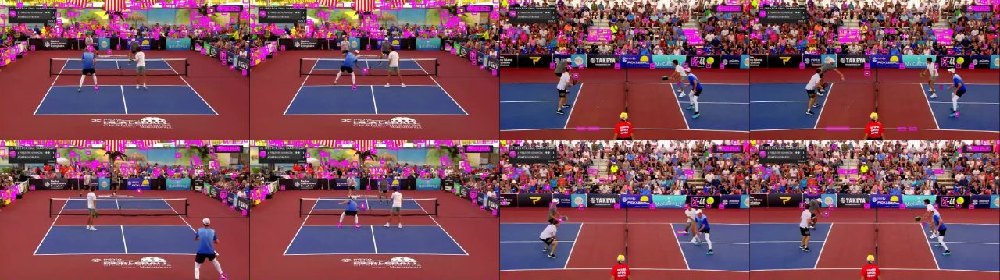

# Highlight pha bóng: thuật toán, các bước xử lý và tình trạng theo mục tiêu

*anhnhc · cập nhật 08/11/2026 · nhánh `rally-highlight` · code ở `core.py`*

**Bổ sung sau merge local:** xem [đối chiếu ba mục tiêu](../project-audit.md) về công cụ quỹ đạo ứng viên, sự kiện xác nhận, ghép toàn bộ pha và xử lý ảnh. Các số liệu trong báo cáo này vẫn là kết quả của nhánh tác giả; công cụ mới chưa được đo trên trận có nhãn nên không thay thế các kết luận dưới đây.

Ghi chú này bám theo 3 mục tiêu của đề tài. Với mỗi mục tiêu, nó ghi rõ đã làm gì, bằng thuật toán nào, đo được gì, và còn thiếu gì. Mọi con số đo trên một trận pickleball 67 phút (854×480, 29,97 fps) bằng code hiện tại của nhánh.

**Ai trong nhóm (người hay agent) thấy làm được việc nào ở mục 7 "Việc mở" thì nhận và làm**, không cần chờ ai duyệt trước.

## 1. Mục tiêu đề tài

1. **Tìm thuật toán và các bước xử lý ảnh để xác định pha bóng.** Ví dụ: bắt keyframe có hình quả bóng và mặt vợt chạm nhau (bắt đầu, tiếp tục một pha); nối các khung cho tới khi quả bóng rơi xuống sàn mà không chạm mặt vợt (kết thúc pha).
2. **Ghép toàn bộ các pha bóng** (có timecode bắt đầu, kết thúc) thành một video highlight.
3. **(Làm thêm) Ảnh hoặc video góc ngang của vận động viên** để đăng Facebook, như phóng viên hiện trường: bắt khoảnh khắc đẹp nhất, xử lý, tăng độ nét, giảm mờ.

## 2. Tình trạng

| Mục tiêu | Đã làm | Còn thiếu |
|---|---|---|
| 1. Xác định pha bằng bóng và vợt | **Bản nền gián tiếp** (mục 3.2): pha = camera sân đang lên hình VÀ khán giả im. Chạy được, tách 154 pha | **Chưa có bước nhận bóng hay vợt.** Ranh giới pha đang lấy từ âm thanh, chưa phải từ sự kiện bóng–vợt–sàn. Kế hoạch ở mục 3.3 |
| 2. Ghép pha có timecode | **Có**: mỗi pha có `start`/`end` (giây) trong `report.json`; video ghép theo thứ tự thời gian, mỗi pha lấy trọn (mục 4) | Timecode đang đến từ bản nền; khi mục 3.3 xong sẽ thay bằng timecode bóng–vợt |
| 3. Ảnh góc ngang, tăng nét, giảm mờ | **Một phần**: chọn được khung cầu thủ lúc vung vợt, khoảng 4/12 ảnh dùng được (mục 5.1) | Chưa lọc riêng camera góc ngang; **chưa có bước tăng nét, giảm mờ** (kế hoạch mục 5.2) |

Chưa có nhãn của người gán nên **chưa có số đo độ chính xác** cho mục tiêu nào; các kết luận về chất lượng đều là kiểm bằng mắt. Các việc còn lại ở mục 7.

## 3. Mục tiêu 1: xác định pha bóng

### 3.1 Định nghĩa pha bóng (dùng làm chuẩn)

Pickleball có **luật hai lần nảy**: cú giao bóng và cú trả giao phải để bóng chạm sàn trước khi đánh. Vì vậy "bóng rơi xuống sàn" chưa chắc đã hết pha. Nhóm dùng định nghĩa sau; ai gặp trường hợp không khớp (giao bóng lỗi, giao lại do chạm lưới…) thì bổ sung vào đây, kèm timecode ví dụ trong video:

- **Bắt đầu pha:** cú chạm vợt đầu tiên là cú giao bóng.
- **Tiếp tục:** mỗi lần quỹ đạo bóng đổi hướng đột ngột cạnh một cầu thủ là một cú chạm vợt.
- **Kết thúc pha:** bóng chạm sàn mà sau đó không có cú chạm vợt nào, hoặc bóng ra ngoài sân, hoặc vào lưới.

### 3.2 Bản nền đang chạy (gián tiếp, không nhận bóng)

**Vì sao cần.** Cách cũ chia video theo "chuyển cảnh" (độ lệch histogram HSV + sai khác khung) và chấm điểm từng mẩu ≤ 4 giây. Trên trận 67 phút nó báo **1 243** lần chuyển cảnh và cho highlight **519** đoạn dài trung vị **1,0 s**, cắt ngang cả lúc chuẩn bị phát bóng. Người chạy, bóng bay làm histogram đổi nên bị tưởng là chuyển cảnh.

**Ý tưởng.** Trên sóng truyền hình, một pha bóng có hai dấu hiệu cùng lúc:

1. **Hình:** đài dùng **camera cố định quay toàn sân**; bố cục màu gần như không đổi, hình gần như đứng yên. Cận mặt, khán giả, phỏng vấn, đồ họa quay tay, zoom, lia hoặc là hình động, chuyển động lớn hơn khoảng 10 lần.
2. **Tiếng:** trong lúc đánh khán giả im; hết pha thì reo.

Pha bóng = **camera sân đang lên hình VÀ khán giả đang im**. Hai ngưỡng do **Otsu** tự chọn theo từng video.

**Các bước** (`analyze`, `audio_loudness`, `detect_rallies`):

1. **Lấy mẫu** 2 khung/giây (`grab()` bỏ qua khung không cần, `retrieve()` khung lấy mẫu); thu về 320×180. Trận này: 8 022 khung mẫu, phân tích 107 s trên CPU.
2. **Đặc trưng hình mỗi khung:** bố cục màu = ảnh **Lab** thu về **16×9** (`INTER_AREA`), duỗi thành vector 432 số; chuyển động = trung bình độ lớn **optical flow Farneback** giữa hai khung mẫu liền nhau (px). Lab vì khoảng cách gần với cảm nhận màu của mắt; 16×9 để giữ bố cục lớn và bỏ chi tiết người chạy.
3. **Âm lượng:** tách âm thanh bằng ffmpeg (mono, 8 kHz), tính **RMS trong cửa sổ 0,5 s** quanh mỗi khung mẫu, đổi sang dBFS.
4. **Gom cụm góc camera:** **K-means 12 cụm** trên vector bố cục màu (`random_state=42`).

   

5. **Tìm camera sân:** lấy trung vị chuyển động của mỗi cụm, chạy **Otsu trên log** của nó (trọng số = số khung). Ngưỡng ≈ 0,54 px/khung: 3 cụm sân có trung vị 0,44–0,54, chín cụm còn lại 2,7–6,9. Phải dùng thang log vì chuyển động khác nhau theo tỉ lệ; trên thang thường ngưỡng rơi vào 2,75 và cụm phỏng vấn (2,74) bị xếp nhầm vào "sân". Kết quả: 4 526 khung mẫu (37,8 phút) thuộc camera sân. Trong đó **cụm 1 là góc ngang** (quay từ bên hông, lưới dựng giữa hình), cụm 2 và 5 quay dọc sân từ sau đường biên cuối.

   

6. **Tìm lúc khán giả im:** **Otsu** trên âm lượng cả trận cho ngưỡng **−26,3 dBFS**. Trung vị: camera sân lúc im −30,4 dB; camera sân lúc ồn −21,8 dB; các cảnh khác −21,1 dB.

   

7. **Ghép pha:** `chơi = camera sân AND im`; lấp lỗ ≤ 1 s giữa hai đoạn chơi; bỏ đoạn < 1,5 s; mở rộng **1 s trước** (không lùi quá đầu cảnh sân) và **2 s sau**; hai pha chồng phần mở rộng thì cắt ở giữa khoảng nghỉ.

   

   *150 giây từ 43:04. Dải xanh trên: camera sân. Vàng: pha tách được. Vạch xanh dưới đáy: pha được chọn vào highlight 10 %.*

8. **Chấm điểm pha:** trung bình hai thứ hạng phần trăm trong trận: **độ dài pha** và **âm lượng lớn nhất trong 3 s sau pha** (tiếng reo). Dùng thứ hạng để giây và dB về cùng thang 0–1.

**Kết quả:** 154 pha; độ dài p10 / trung vị / p90 / dài nhất = 1,5 / 6,3 / 18,5 / 33,5 s; tổng 21,9 phút.


**Loại cảnh bị bỏ ở bước nào:**

| Loại cảnh | Bị loại ở bước | Lý do |
|---|---|---|
| Cận mặt vận động viên, khán giả | 5 | Quay tay, zoom: chuyển động trung vị 5–7 px/khung |
| Phỏng vấn sau trận | 5 | Bố cục khác sân; chuyển động 2,7 px/khung, vẫn trên ngưỡng log |
| Đồ họa, logo, flycam | 5 | Hình động, chuyển động lớn |
| Toàn sân lúc giữa hai điểm | 6 | Camera sân nhưng âm lượng trên ngưỡng (trung vị −21,8 dB) |
| Toàn sân lúc đang đánh | được giữ | Camera cố định và khán giả im |

**Giới hạn của bản nền:**

- Không nhìn thấy quả bóng, nên không biết pha bắt đầu và kết thúc đúng ở cú đánh nào; ranh giới lệch theo phản ứng của khán giả.
- Camera lia theo bóng bị loại: cụm 0 và cụm 4 có lẫn cảnh sân quay khi camera lia; phần pha bóng chiếu bằng camera đó bị mất hoặc làm pha bị cắt đôi.
- 43 pha chỉ dài 1,5–3 s, nhiều khả năng là lúc im giữa hai điểm.
- Phát bóng ăn điểm trực tiếp bị lép vế vì pha ngắn, chỉ được bù nếu tiếng reo rất to.
- Dựa vào khán giả im lặng: dùng được cho pickleball, tennis; không dùng nguyên được cho môn khán giả ồn suốt trận.
- Mới chạy trên một trận; K = 12 chưa thử với video khác.

### 3.3 Kế hoạch bắt bóng và vợt (chưa làm: việc V3, V4)

**Đã đo:** tách màu vàng của quả bóng bằng ngưỡng HSV trên 24 khung camera sân cho ra **54–176 vật màu vàng mỗi khung**: khán giả, chữ quảng cáo, bảng điểm, mũ vàng của trọng tài, giày cầu thủ. Quả bóng ở 480p chỉ cỡ vài pixel. Vậy **chỉ dùng màu là không đủ**.



*Khung tím: vật màu vàng tách theo HSV. Hai cột trái là camera dọc sân, hai cột phải là camera góc ngang.*

Các bước đề xuất, đều là kỹ thuật trong môn học:

1. **Chỉ xét các đoạn bản nền đã khoanh** (camera sân, khán giả im) để giảm khối lượng và nhiễu.
2. **Đọc đủ 30 khung/giây** trong các đoạn đó (bóng bay nhanh; 2 khung/giây của bản nền là quá thưa).
3. **Mặt nạ vùng sân:** chỉ giữ pixel trên màu sàn và một dải phía trên sàn; bỏ khán đài, bảng quảng cáo, bảng điểm.
4. **Trừ nền** (MOG2 hoặc sai khác ba khung liên tiếp): chỉ giữ vật đang chuyển động; loại mũ trọng tài, chữ đứng yên.
5. **Ứng viên bóng** = tiền cảnh ∩ màu vàng (HSV) ∩ kích thước nhỏ ∩ gần tròn (tỉ lệ diện tích trên hộp bao).
6. **Bám quỹ đạo:** nối ứng viên qua các khung theo khoảng cách gần nhất, dự đoán bằng vận tốc (hoặc lọc Kalman); bỏ điểm không nối được.
7. **Sự kiện:**
   - *Chạm vợt:* quỹ đạo đổi hướng đột ngột trong hoặc sát hộp bao một cầu thủ (đã có cách tìm cầu thủ ở mục 5.1).
   - *Chạm sàn:* vận tốc theo phương dọc màn hình đổi dấu ở xa cầu thủ.
   - *Kết thúc:* theo định nghĩa mục 3.1.
8. **Timecode pha** = từ cú giao bóng tới sự kiện kết thúc, mỗi bên cộng một khoảng đệm.

Rủi ro đã biết: bóng chỉ vài pixel và bị nhòe khi bay nhanh; bị lưới, người che; góc dọc sân khó thấy độ cao bóng. Cần thử trên vài pha trước khi kết luận cách này làm được.

## 4. Mục tiêu 2: ghép các pha thành highlight

- **Chọn pha** (`select(mode='rally')`): xếp theo điểm giảm dần, lấy dần cho tới hết ngân sách thời lượng. **Một pha hoặc lấy trọn, hoặc bỏ**, không cắt ngắn. Có thể dùng knapsack 0/1 thay cho tham lam.
- **Timecode:** mỗi pha ghi `start`, `end` (giây trong video gốc) vào `report.json`; giao diện hiện dạng phút:giây.
- **Ghép** (`export_video`): ffmpeg cắt từng pha (mã hóa lại H.264 + AAC), rồi nối theo đúng thứ tự thời gian.

| Highlight | Số pha | Tổng | Mỗi pha |
|---|---|---|---|
| 5 % | 7 | 3,3 phút | 15,5–36,5 s |
| 10 % | 17 | 6,7 phút | 12,5–36,5 s |
| 15 % | 29 | 10,0 phút | 3,3–36,5 s |

Xuất video 10 % mất 14 s. Trong 17 pha của bản 10 %, 11 pha có điểm giữa nằm ở camera góc ngang (cụm 1).


*Bốn pha điểm cao nhất, mỗi hàng một pha. Từ trái: 1 s trước phát bóng, lúc phát bóng, giữa pha, cuối pha, tiếng reo.*

## 5. Mục tiêu 3: ảnh góc ngang của vận động viên

### 5.1 Đã làm: chọn khung lúc vung vợt (`best_shots`, thử nghiệm)

Trong mỗi pha được chọn: trừ nền **MOG2**, lọc hình thái (mở, đóng, co), gán nhãn thành phần liên thông; giữ thành phần cao hơn 12 % khung, cao hơn rộng, **chân đứng trên màu sàn**, không chạm mép khung; bám cùng một người qua các khung bằng độ chồng hộp (IoU). "Lúc ra lực" = lúc **dáng người đổi nhiều nhất**, đo bằng `1 − IoU` mặt nạ hai khung liên tiếp; quanh đó lấy khung có **phương sai Laplacian** (độ nét) lớn nhất. Ảnh được cắt từ khung gốc, không phóng to.

Kết quả: khoảng 4/12 ảnh dùng được; số còn lại dính hai người, chỉ được phần chân, hoặc dính bảng quảng cáo. 8/12 ảnh lấy từ camera góc ngang, 4 ảnh từ camera dọc sân. Cầu thủ trong khung cao 70–300 px.

### 5.2 Kế hoạch (chưa làm: việc V1, V6)

1. **Chỉ lấy camera góc ngang** (cụm có lưới dựng giữa hình; trong trận này là cụm 1).
2. **Chọn khoảnh khắc** tốt hơn: dùng sự kiện chạm vợt của mục 3.3, lấy khung ngay trước, đúng lúc và ngay sau khi chạm.
3. **Xử lý ảnh** (theo slide môn Xử lý Ảnh và Video số):
   - Tăng nét: **unsharp mask** (Ví dụ 1.3).
   - Giảm mờ do chuyển động: **Richardson–Lucy** hoặc **Wiener** với hàm trải điểm theo hướng chuyển động (Ví dụ 1.5, Bài 5).
   - Khử nhiễu trước khi tăng nét: lọc trung vị hoặc lọc thống kê (Bài 5).
   - Phóng to bằng nội suy song khối nếu cần (Ví dụ 2.10).
4. **Video góc ngang ngắn:** cắt 1–2 s quanh cú đánh từ camera góc ngang.

Giới hạn: video gốc 480p nên ảnh đăng Facebook bị giới hạn độ phân giải; có bản 1080p thì kết quả khác hẳn.

## 6. Chạy lại

```bash
.venv/bin/python -m streamlit run app.py --server.address 127.0.0.1
```

Chọn loại video "Thể thao có pha bóng". Test của phần này ở `tests/test_rally.py` (7 test, dữ liệu tổng hợp).

## 7. Việc mở: ai làm được thì nhận

Cách nhận: ghi tên mình và ngày vào cột "Người nhận" trong bảng này, commit lên nhánh rồi làm. Xong thì ghi kết quả vào mục báo cáo tương ứng, cập nhật bảng mục 2 và bảng "Báo cáo trong `reports/`" ở đầu `README.md`, rồi sinh lại HTML (mục 8). Số liệu phải đo được và kèm lệnh hoặc script để chạy lại; kiểm bằng mắt thì ghi rõ là kiểm bằng mắt.

| # | Việc | Thuộc mục tiêu | Xong khi | Ghi kết quả vào | Người nhận |
|---|---|---|---|---|---|
| V1 | Tìm video pickleball phát sóng ≥ 1080p, có camera góc ngang | 1, 3 | Có file hoặc link dùng được, kèm URL, tác giả, giấy phép, ngày truy cập (theo mục "Dữ liệu và giao thức" của README) | `README.md` mục dữ liệu; mục 5.2 | |
| V2 | Gán nhãn người cho trận thử: start/end từng pha theo định nghĩa mục 3.1 | 1, 2 | Có file JSON nhãn (định dạng ở README, tạo được ở tab "Gán nhãn" của app) cho ít nhất một đoạn của trận, và F1 của bản nền so với nhãn đó | Mục 2, mục 3.2 | |
| V3 | Thử bắt bóng theo kế hoạch mục 3.3 trên vài pha | 1 | Có script chạy được, hình quỹ đạo bóng vẽ chồng lên khung, và tỉ lệ khung có bóng bắt được so với đếm tay trên các pha thử | Mục 3.3 | |
| V4 | Nhận cú chạm vợt và lúc bóng chạm sàn từ quỹ đạo (cần V3) | 1 | Có timecode từng cú chạm, so với đếm tay trên các pha thử | Mục 3.3; khi ổn thì thay timecode ở mục 4 | |
| V5 | Giữ cảnh sân quay bằng camera lia (đang bị loại, xem giới hạn mục 3.2) | 1 | Các pha có đoạn camera lia không còn bị mất hoặc cắt đôi; so số pha trước và sau | Mục 3.2 | |
| V6 | Ảnh góc ngang: chỉ lấy camera góc ngang, tăng nét, giảm mờ theo mục 5.2 | 3 | Bộ ảnh trước và sau xử lý của cùng các khung, kèm thông số bộ lọc đã dùng | Mục 5 | |

## 8. Sinh lại bản HTML

Bản HTML được sinh từ file `.md`; sửa file `.md` rồi chạy:

```bash
pip install markdown
python reports/build_html.py
```

Kiểu trang ở `reports/report.css`. Không sửa tay file `.html`.
