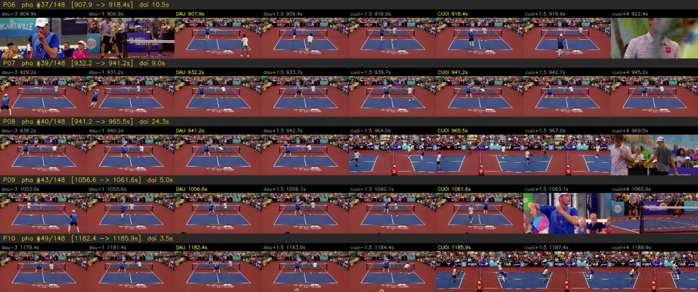
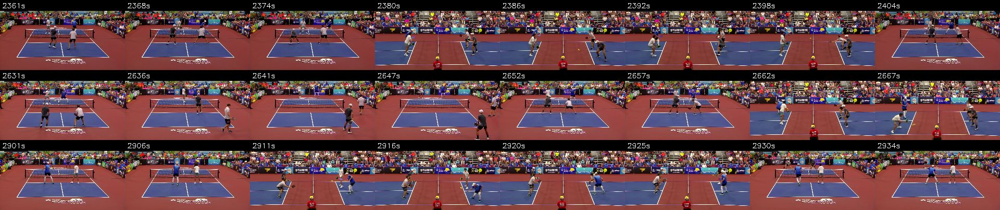
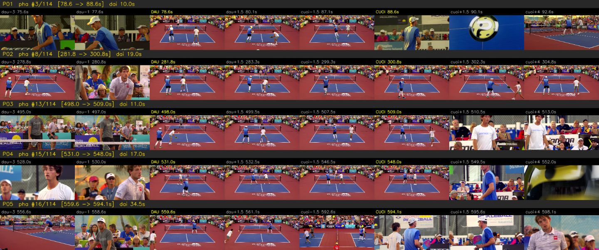

# QC video highlight trận 67 phút: lỗi ở đâu, sửa được bao nhiêu, độ chính xác còn lại

*QC · 11/11/2026 · nhánh `qc/rally-highlights-review` (đã merge `origin/rally-highlight` tới `2051548`) · trận `youtube.com/watch?v=pthJ1IQPqGE`*

**Yêu cầu:** highlight của trận 67 phút dài ~28 phút (41% thời lượng gốc) — quá dài để xem hết. Tìm chỗ sai, thống kê, xem sửa được không; không sửa được thì báo độ chính xác.

## 1. Kết luận

| | Trước sửa (mặc định cũ) | Sau sửa (mặc định mới `gap=5`, `pre=3`) |
|---|---|---|
| Mẫu kiểm | 30 pha + 15 khoảng bị loại (seed 7) | **mẫu độc lập** 20 pha + 10 khoảng (seed 11) |
| **Pha đúng hoàn toàn** | **10/30 = 33%** (±17%) | **14/20 = 70%** (±20%); 14/17 = 82% nếu bỏ 3 ca ảnh tĩnh không phân xử được |
| Pha có lỗi rõ ràng | 19/30 = 63%, 6 loại lỗi | 3/20 = 15%, chỉ còn 1 loại (cắt đuôi) |
| Khoảng bị loại đúng | 13/15 = 87% (2 sót pha) | 9/10 = 90% (0 sót rõ, 1 không rõ) |
| Highlight | 148 pha · 27,7 phút (41%) | 114 pha · 32,2 phút (48%) |

**Sửa được phần lớn:** chỉ bằng hai tham số, lỗi rõ ràng giảm từ 63% xuống 15%, không làm hỏng mẫu đúng nào, đổi lại highlight dài thêm 4,5 phút. **Phần còn lại không sửa được bằng tham số** (mục 5). Độ dài highlight nên điều khiển bằng **ngân sách chọn pha**, không phải bằng cách cắt pha: trên trận này bản 25% = 41 pha / 16,7 phút, bản 10% = 13 pha / 6,7 phút — mỗi pha vẫn trọn.

## 2. Cách QC không cần xem hết 28 phút

Lỗi của bộ tách pha nằm ở **mốc cắt**, không nằm giữa pha. Vì vậy lấy mẫu ngẫu nhiên có hạt giống cố định và chỉ soi quanh các mốc (`reports/qc/qc_highlight_mau.py`):

- **Mỗi pha một hàng 8 khung:** đầu−3s, đầu−1s, ĐẦU, đầu+1,5s | cuối−1,5s, CUỐI, cuối+1,5s, cuối+4s.
- **Mỗi khoảng bị loại (≥ 4 s) 4 khung** ở 15/38/62/85% — để bắt pha bị sót.
- Người QC gán nhãn từ bảng nhãn cố định; số liệu tính bằng `--thong-ke`, khoảng tin cậy 95% theo xấp xỉ chuẩn.
- Pha dài nghi gộp nhầm (> 35 s) được soi thêm 8 khung giữa pha.

| Nhãn | Nghĩa |
|---|---|
| `DUNG` | có cú giao bóng ở đầu, điểm đã kết thúc ở cuối |
| `TRE_GIAO` | pha còn nguyên nhưng bắt đầu trễ ~1 s, mất động tác giao bóng |
| `CAT_DAU` | lúc bắt đầu bóng đã đang bay |
| `CAT_DUOI` | sau mốc cuối vẫn đang đánh |
| `CAT_HAI_DAU` | mảnh vụn giữa pha |
| `TACH_DOI` | nửa sau của một pha bị chặt đôi (bắt đầu đúng mốc cuối của pha trước — hình liền nhưng đếm thừa) |
| `KHONG_PHAI_PHA` | nghỉ giữa điểm / cận mặt / replay bị nhận là pha |
| `LOAI_DUNG` / `SOT_PHA` | khoảng bị loại đúng / đang có giao tranh mà bị loại |
| `KHONG_RO` | ảnh tĩnh không đủ phân xử (vd. đang đánh hay replay) |

Ảnh mẫu (trước sửa): P07 + P08 là một pha bị chặt đôi tại 941,2 s; P10 là mảnh 3,5 s giữa pha.



## 3. Trước sửa: lỗi nào, bao nhiêu (seed 7, 30 pha + 15 khoảng)

| Nhãn | Số | Tỷ lệ |
|---|---|---|
| `DUNG` | 10 | 33% |
| `CAT_DUOI` | 6 | 20% |
| `CAT_DAU` | 4 | 13% |
| `TRE_GIAO` | 3 | 10% |
| `TACH_DOI` | 3 | 10% |
| `CAT_HAI_DAU` | 2 | 7% |
| `KHONG_PHAI_PHA` | 1 | 3% |
| `KHONG_RO` | 1 | 3% |
| khoảng: `LOAI_DUNG` / `SOT_PHA` | 13 / 2 | 87% / 13% |

Quan sát: các "pha" ≤ 5 s gần như đều là mảnh vụn; các pha chặt đôi đều rơi vào **pha hay nhất** (khán giả "ồ" giữa pha).

## 4. Nguyên nhân gốc: cổng âm thanh chập chờn

Trận này có **bình luận viên nói trong lúc đánh**, nên ngưỡng "khán giả im" (Otsu trên âm lượng cả trận) tụt xuống **−31,5 dBFS** — chỉ những tích tắc rất lặng mới được tính là đang chơi. Ví dụ khoảng bị loại K01 (71–113 s): camera sân đạt suốt (điểm khớp 0,91–0,93 > ngưỡng 0,67) nhưng âm lượng −22…−25 dBFS, chỉ 2 mẫu lọt dưới ngưỡng. Chuỗi "đang chơi" vì thế bật/tắt liên tục; với lấp lỗ chỉ 1 s, mỗi lần tắt > 1 s là một nhát cắt — sinh ra đủ cả `CAT_DAU`, `CAT_DUOI`, `TACH_DOI`, `CAT_HAI_DAU`. Còn `TRE_GIAO` do đệm trước 1 s ngắn hơn khoảng từ lúc camera sân lên hình tới cú giao.

## 5. Thử phương án sửa trên chính các mẫu lỗi

Mỗi mẫu lỗi có một "điểm cắt" cụ thể; phương án *vá* khi điểm đó nằm gọn trong một đoạn (có lề 1–2 s), *hỏng* khi mẫu `DUNG` bị tách hoặc khoảng `LOAI_DUNG` bị phủ ở khung giữa (`reports/qc/qc_highlight_sua.py`, dữ liệu `data/qc67_phuong_an_sua.csv`):

| Phương án | Vá | Hỏng | Số đoạn | Phút |
|---|---|---|---|---|
| A cũ (lấp 1 s, đệm 1 s) | 0/21 | 0/23 | 148 | 27,7 |
| B lấp 3 s | 11/21 | 0/23 | 125 | 29,8 |
| C lấp 5 s | 14/21 | 0/23 | 114 | 31,0 |
| D chỉ camera sân | 18/21 | 5/23 | 124 | 42,4 |
| E camera sân + có ≥ 1,5 s im | 18/21 | 2/23 | 114 | 36,4 |
| **F đã chọn: lấp 5 s, đệm 3 s** | **17/21** | **0/23** | **114** | **32,2** |

Quét `gap` 4–10 s × `pre` 1–3 s: vùng `gap` 4–5 s là **vùng phẳng không hỏng**; từ `gap` 6 s bắt đầu gộp nhầm điểm khác (hỏng 1 → 7, đoạn dài tới 162 s). Đã đổi mặc định của `detect_rallies` thành `gap=5, pre=3` (kèm test `test_mid_rally_noise_no_longer_splits_the_rally`; các test cơ chế cũ ghim tham số cũ). Lưu ý: 17/21 là số **trong mẫu dùng để chọn** — số độ chính xác thật lấy từ mẫu độc lập ở mục 6.

## 6. Sau sửa: mẫu độc lập (seed 11, 20 pha + 10 khoảng)

| Nhãn | Số | Tỷ lệ |
|---|---|---|
| `DUNG` | 14 | 70% |
| `CAT_DUOI` | 3 | 15% |
| `KHONG_RO` | 3 | 15% |
| khoảng: `LOAI_DUNG` / `KHONG_RO` | 9 / 1 | 90% / 10% |

Năm trên sáu loại lỗi không còn xuất hiện. Ví dụ: P03 cũ (trễ giao) nay bắt đầu đúng khung giao bóng 498,0 s; mảnh 2,8 s cũ (P16) nay liền thành pha 12,5 s; vùng K01 cũ (sót) nay được phủ. Rủi ro mới của lấp lỗ dài là gộp nhầm hai điểm — đã soi giữa ba pha dài nhất (49 s, 42 s, 39 s): giao tranh liên tục, luân phiên camera chính ↔ camera hông, không có cảnh nghỉ:





Kiểm chéo trên video 11 phút (`PMRSb3ogWq4`, cũng có BLV): mặc định mới nối ba mảnh 94,5 → 98,2 → 105,5 → 116 s thành một pha; chế độ âm thanh nay cho 19 pha / 8,3 phút, không còn cần chế độ "chỉ camera sân" làm lối thoát.

## 7. Phần không sửa được bằng tham số (độ chính xác còn lại ≈ 70–82% pha đúng)

| Lỗi còn lại | Ví dụ | Vì sao tham số không cứu | Cần gì |
|---|---|---|---|
| Cắt đuôi khi pha kết thúc trong tiếng ồn (giao tranh hấp dẫn ở bếp, khán giả la to trước khi hết điểm) | P11, P15, P16 (sau sửa) | âm thanh đã ồn > 5 s trước khi hết điểm | tín hiệu chuyển động/bóng: kéo dài pha khi camera sân còn và cầu thủ còn di chuyển |
| Giao tranh thật quay bằng camera hông | K06 (trước sửa) | camera hông dùng cho cả live lẫn replay; điểm khớp 0,57–0,61 dưới ngưỡng | nhận diện replay bằng hiệu ứng chuyển cảnh quả bóng "?" (replay luôn kẹp giữa hai hiệu ứng này) |
| Nghỉ giữa điểm mà khán giả im | P24 (trước sửa) | âm thanh và camera đều "đúng" | chuyển động/bóng |
| Chuyển zoom mờ giữa pha | video 11 phút, 57,5 s | điểm khớp khuôn rơi 0,62 vài giây | bám khuôn có bù tỷ lệ (việc mở V5) |

## 8. Giới hạn của đợt QC

- Một trận, một người gán nhãn (agent QC), từ **ảnh tĩnh** — ca nào ảnh tĩnh không phân xử được đều ghi `KHONG_RO` chứ không đoán; độ chính xác báo cả hai cách tính (tính `KHONG_RO` là sai / bỏ ra).
- Cỡ mẫu nhỏ: khoảng tin cậy ±17–20%. Hướng tiếp: người thứ hai gán nhãn độc lập cùng các tấm ảnh (seed cố định nên ai chạy cũng ra đúng mẫu) để đo độ đồng thuận.
- Ảnh trong app của anh Công Anh (158 pha / 28:56) là bản chưa có hysteresis; bản QC (148 / 27,7 phút) có — cùng hệ, chênh 6%.

## 9. Chạy lại

```bash
# phân tích trận (≈ 6 phút trên CPU, 1080p)
.venv/bin/python -c "from core import analyze; analyze('video_thu_nghiem/match2.mp4','runs/match67_v2/analysis')"
# mẫu trước sửa (nhãn ở data/qc67_truoc_nhan.csv) — dùng mặc định cũ khi sinh ảnh:
#   git checkout 025ff72 -- core.py   rồi chạy lệnh dưới, xong khôi phục core.py
.venv/bin/python reports/qc/qc_highlight_mau.py video_thu_nghiem/match2.mp4 runs/match67_v2/analysis runs/qc_mau audio 30 15 7
# mẫu sau sửa (mặc định mới)
.venv/bin/python reports/qc/qc_highlight_mau.py video_thu_nghiem/match2.mp4 runs/match67_v2/analysis runs/qc_mau_sau audio 20 10 11
# thống kê và bảng phương án
.venv/bin/python reports/qc/qc_highlight_mau.py --thong-ke reports/qc/data/qc67_truoc_nhan.csv
.venv/bin/python reports/qc/qc_highlight_mau.py --thong-ke reports/qc/data/qc67_sau_nhan.csv
.venv/bin/python reports/qc/qc_highlight_sua.py runs/match67_v2/analysis reports/qc/data/qc67_truoc_nhan.csv
```
